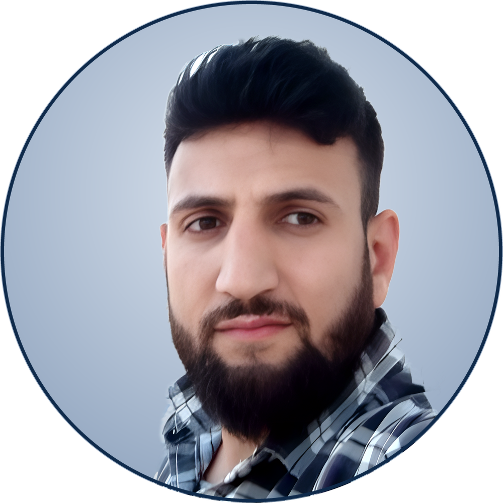

<div align="center">


<br/>



### 👋 Hi there, I'm Abdulrahman

**Software Engineer · Backend-Focused Full-Stack Developer**

[](https://github.com/abdulrahmanHijazi)
[](https://github.com/abdulrahmanHijazi)
[](mailto:eng.abdulrahman.hijazi@gmail.com)
[](https://maps.google.com/?q=Damascus,Syria)

</div>

---

### 🧑‍💻 About Me

```yaml
name: Abdulrahman Hijazi
role: Software Engineer | Backend-Focused Full-Stack Developer
based: Damascus, Syria 🇸🇾  # open to remote work
experience: 3+ years shipping production web & mobile systems
education: B.Sc. Software Engineering — Damascus University (2019–2024)
languages:
  Arabic: native
  English: professional
current_focus:
  - Scalable RESTful APIs & modular monolith architecture (Laravel)
  - Multi-tenant SaaS, offline-first PWAs & Filament admin panels
  - Bilingual (AR/EN) products with full RTL support
  - Performance tuning: Eloquent, raw SQL, MySQL indexing, Redis
fun_fact: I turn coffee into CRMs, POS systems and marketplaces ☕
```

<br>

### 💼 Experience

| Role | Company | Period |
|---|---|---|
| 🔹 **Backend Developer** | **Vega** — remote (Istanbul, TR) | 12/2024 – Present |
| 🔹 Android Developer | 3Now / Mos Gruppe — Damascus | 01/2023 – 12/2023 |
| 🔹 Freelance Network & IT Support | Self-employed | 2016 – Present |

**At Vega:** designed secure RESTful APIs for web & mobile · built an **18-module Modular Monolith** (Laravel + Inertia + Vue 3 + Redis/Horizon + Reverb) · optimized complex Eloquent/SQL queries & MySQL indexing for Filament dashboards · auth with Sanctum/Passport & role-based permissions · integrated **Stripe, Firebase FCM, Vimeo, WebSockets** · PHPUnit/Pest testing in Agile sprints.

**At 3Now:** shipped the **3NOW delivery app on Google Play** (Kotlin) — live order tracking, pre-booking, in-app payments, Room/SQLite offline storage.

<br>

### 🚀 Production Platforms

| Project | Description | Stack |
|---|---|---|
| 🎓 **Shamel Edu** | E-learning platform (18 modules): orders, payments, wallet, attendance, live lessons, real-time chat | Laravel 13, Filament, Inertia, Vue 3, Redis/Horizon, Reverb, FCM, Stripe, Vimeo |
| 🩺 **Altabeb (الطبيب)** | Booking system for doctors, hospitals, pharmacies & labs with online appointments/consultations | Laravel, Filament/Nova, Sanctum, MySQL |
| 🛵 **Yumzy** | Food & grocery delivery backend: warehouses, delivery zones, coupons, loyalty points, order tracking | Laravel, Filament, Sanctum, Redis Queue |
| 🚗 **Shater (شاطر)** | Auto-parts marketplace with buyer–seller chat, reviews and SEO-optimized pages | Laravel, Filament, Sanctum, FCM |
| ✈️ **Booking-24** | Car-rental & airport-transfer API with dynamic pricing and a driver/trip admin panel | Laravel, Filament, Sanctum, FCM |
| 🏠 **Aqar & Service** | Graduation project — led the team, UML analysis/design, backend development | Laravel, WebSockets, Queues, Agora, Design Patterns |

<br>

### 🚀 Featured Repositories

| | Repository | Description |
|---|---|---|
| 🏪 | [**Al-Nasr_Company**](https://github.com/abdulrahmanHijazi/Al-Nasr_Company) | Full e-commerce store — brands, nested categories, bundles & offers, bilingual content, Filament 5 admin |
| 🧾 | [**pos-douma**](https://github.com/abdulrahmanHijazi/pos-douma) | Multi-tenant SaaS POS — **offline-first PWA** cashier (Dexie/IndexedDB sync), barcode sales, dual-currency SYP/USD |
| 🌐 | [**Protfilo-Project**](https://github.com/abdulrahmanHijazi/Protfilo-Project) | Bilingual portfolio (AR-RTL / EN-LTR) with admin-managed **3D three.js scenes**, Filament 5 + Shield |

<br>

### 🛠️ Skills

<div align="center">


</div>

| Area | Skills |
|---|---|
| **Backend** | PHP · Laravel · RESTful APIs · Eloquent ORM · Sanctum/Passport · Queues · Redis/Horizon · WebSockets · PHPUnit/Pest |
| **Databases** | MySQL · Oracle · SQL — query optimization & indexing |
| **Frontend / Mobile** | JavaScript · Vue.js · Inertia.js · HTML/CSS · Bootstrap · Kotlin · Java · Android |
| **Admin & Integrations** | Filament · Laravel Nova · Stripe · Firebase FCM · Vimeo · Google Maps · Agora |
| **Practices** | Git · Jira · Azure DevOps · UML · OOP · Clean Code · Design Patterns · Systems analysis & design |

<br>

### 🎓 Education & Certifications

- 🎓 **B.Sc. Informational Engineering — Software Engineering**, Damascus University (2019 – 2024)
- 🎓 Diploma in Network Engineering, Masar Academy (2015 – 2017)
- 📜 **Coursera:** Version Control · JavaScript · Kotlin · HTML & CSS · Android Mobile Development

<br>

### 📊 GitHub Stats

<div align="center">


<br/>


<br/>


</div>

<br>

### 📈 Activity Graph


<br>

<div align="center">

### 🤝 Let's Connect

[](https://github.com/abdulrahmanHijazi)
[](mailto:eng.abdulrahman.hijazi@gmail.com)
[](tel:+963954557172)


</div>
